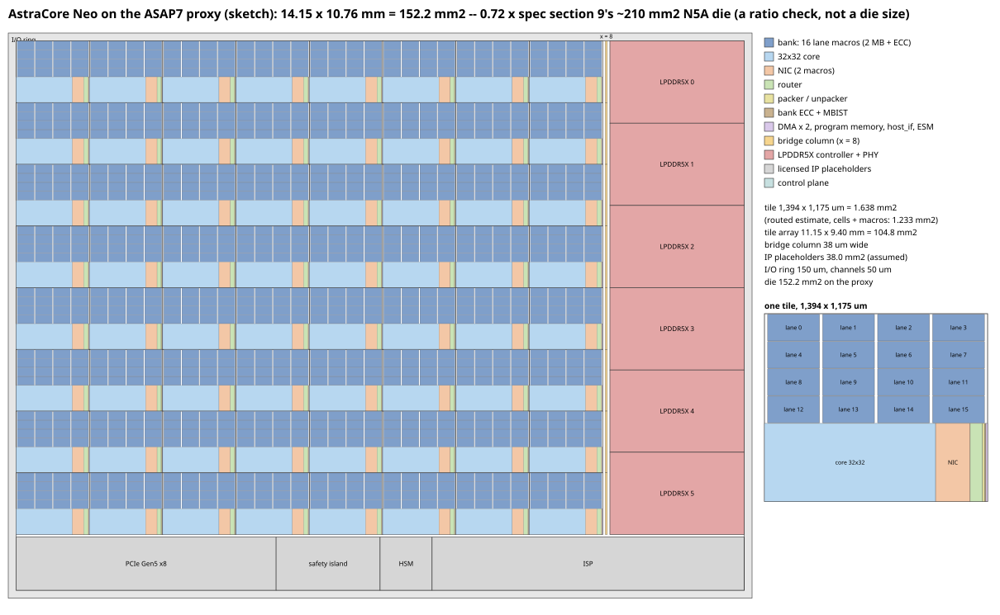

# The chip-level floorplan sketch (drop 0.43, stream A3)

`floorplan.py` draws `floorplan.svg` from `tile_routed.json` and prints the numbers below. `tile_routed.json` is
written by `07_ci/pnr/tile_table.py` from the `pnr` job's routed blocks (`../pnr_drop043.md`: runs 182–197 at 1,250 ps
on ASAP7) and the synthesis job's results of the same RTL (CI run 198); regenerate with `python3
07_ci/pnr/tile_table.py --logs <ci-logs-pnr checkout>/ci_logs/pnr --synth <synth_results.json> --out table.md --json
09_synthesis/floorplan/tile_routed.json` and `python3 09_synthesis/floorplan/floorplan.py`. It is a sketch on the ASAP7
proxy: block areas from routed blocks in a regular arrangement -- no chip-level pin, power-grid, clock or timing
planning.

## What it draws

| Item | Size | From |
| --- | --- | --- |
| the tile (8 × 8) | 1,394 × 1,175 µm = 1.638 mm² each; the array 11.15 × 9.40 mm = 104.8 mm² | the tile as placed (`tile_table.py`): the routed blocks' core areas, the bank's lanes packed |
| the bank in each tile | 16 lanes of 323.6 × 166.6 µm, four across: 1,394.3 × 686.4 µm with the 20 µm pin channels | `bank_bist_wrap`'s macros (run 194) |
| the 32 × 32 core | 0.522 mm² | `neo_core`'s core area at 55 % (run 182; its placement did not finish: `../pnr_drop043.md` section 4) |
| the NIC (two macros) | 0.1056 mm² | `tile_nic`'s core (run 197) |
| the router | 0.0379 mm² | `noc_router`'s core (run 188) |
| the packer + unpacker | 0.0069 mm² | their cores (run 188) |
| the bank's ECC + MBIST logic | 0.0032 mm² | `bank_bist_wrap`'s cells at the median utilization 57.3 % |
| the tile's control | 0.0051 mm² | 2 × `tile_dma`, `prog_mem`, `host_if`, `esm` (run 188) |
| the bridge column | 38 µm wide, a node per row (0.0446 mm²) | synthesized 23,095 µm² × 1.107 at 57.3 % |
| the control plane | 2,426 µm² | synthesized 1,256 µm², likewise |
| LPDDR5X controller + PHY × 6 | 4.0 mm² each, the east edge | assumed (N5A class) |
| PCIe Gen5 × 8, safety island, HSM, ISP | 5.0 / 2.0 / 1.0 / 6.0 mm², the south edge | assumed (N5A class) |
| the I/O ring, the channels | 150 µm each side; 50 µm | assumed |

## The numbers

- **The die: 14.15 × 10.76 mm = 152.2 mm²** on the proxy, **0.72 ×** spec §9's ~210 mm² N5A die.
- The 64 tiles: 104.8 mm², 69 % of the die; the licensed-IP placeholders 38.0 mm² (25 %); the bridge column, the control
  plane, the channels and the ring the rest.
- The tile: 1.638 mm² as placed, against the routed-area estimate 1.233 mm² (cells packed at 100 %, `pnr_drop043.md`)
  and the synthesis flow's 1.221 mm²; the bank's packed lanes 0.957 mm² of it.

## Assumptions

- **The tile is a hard macro, 64 of them in an 8 × 8 array**, abutted: the mesh links between neighbours are the
  routers' ports at the tile edges.
- **Inside the tile:** the bank's 16 lane macros (FakeRAM2.0 `fakeram7_32768x39_cm64_1w1r`, as `bank_bist_wrap` routed
  them) packed four across in four rows, a 20 µm channel in front of each macro's pin edge (FakeRAM2.0 puts every signal
  pin on the left edge; the routed block put the lane's encoder and decoder there) and 4 µm between rows (twice the
  platform's macro halo). The routed block itself placed them three per row in a 1.2 mm core at 60 %, and missed
  1,250 ps by 1.76 ns over those distances (`../pnr_drop043.md` section 2): the packed array with the engine and the
  port mux among the lanes is the arrangement the bank's timing asks for. Below the bank, one strip as wide as the
  bank: the 32 × 32 core, the NIC with its two macros, the router, the packer / unpacker pair, the bank's ECC and MBIST
  logic and the tile's control -- each at the core area its routed block occupied (its cells at the block's
  utilization, its macros at their LEF size), the bank's logic and `neo_tile`'s own glue at the median utilization of
  the routed logic blocks. Widths in the strip are proportional to the areas, in the data path's order (core, NIC,
  router, links).
- **The bridge column at x = 8** (B1's `neo_top`): per row a router, a packer / unpacker pair and a NoC-to-AXI4 bridge
  (memory role; row 0's host role drawn the same), at their synthesized cell areas (the synthesis job's
  `top_noc_router`, `top_link_packer`, `top_link_unpacker`, `noc_axi_bridge_mem`) times the median routed / synthesized
  cell-area ratio, at the median utilization -- no bridge was routed.
- **The control plane** (`top_ctrl`, `mesh_ctrl`) the same way, in the south row.
- **The licensed IP of spec §10's delta table** (not in the RTL), as placeholders. No model in the repository sizes them,
  so N5A-class figures are assumed and drawn unscaled on the proxy -- PHYs and I/O are analog and bump-pitch limited and
  do not shrink with a logic library, and the digital IP is small next to them: six LPDDR5X controller + PHY channels of
  64 bits (spec §4's 384-bit LPDDR5X-8533) at 4.0 mm² each on the east edge; the PCIe Gen5 ×8 controller + PHY 5.0 mm²,
  the ASIL-D safety island (two Cortex-R52+ in lockstep with their TCMs) 2.0 mm², the HSM 1.0 mm², the ISP 6.0 mm² on
  the south edge.
- **The I/O ring** 150 µm on each side (I/O cells, ESD, the redistribution to the flip-chip bumps of spec §9's FCBGA),
  50 µm channels between the tile array, the bridge column, the east IP column and the south IP row.

## What the ratio means

The two dies are different things measured differently. Spec §9's ~210 mm² is the feasibility model's figure for the
whole N5A die, without a breakdown; the IP model (`03_models/model/neo_ip_ppa.py`) sizes the tile at 0.62 mm² on N5A
(0.49 mm² of it the 2 MB bank), so its 64 tiles are 40.7 mm² -- a fifth of that die -- and the other ~170 mm² is uncore
that neither model itemizes. On the proxy the tile is 1.638 mm² as placed, 2.6 times the IP model's: ASAP7 is a
predictive 7 nm library whose cells and wire pitches are larger than a production N5 library's, FakeRAM2.0's bit cell
with its periphery (0.042 µm² per bit) is 1.4 times the IP model's N5 figure (0.029 µm² per bit with periphery, ECC and
redundancy), the packed bank with its pin channels is 0.957 mm² against 0.49, and the logic sits at the utilizations of
first-pass routed blocks. So the 64 tiles are 69 % of the proxy die and the assumed IP 25 %, against about 19 % and 81 %
(tiles and everything else) in spec §9's die.

The 0.72 is therefore not a confirmation of the 210 mm²: the proxy's larger tiles and the placeholders' smaller uncore
offset each other. What the sketch does establish is the size of the tile array on an open 7 nm library -- 104.8 mm² for
the 64 tiles, 61.3 mm² of it the banks' packed macros -- and that spec §9's die figure needs its uncore broken down (the
PHYs, PCIe, the island, the ISP, the HSM, the I/O ring) before it can be checked against anything. A memory compiler's
macros and the target library replace the proxy's half of the comparison.
